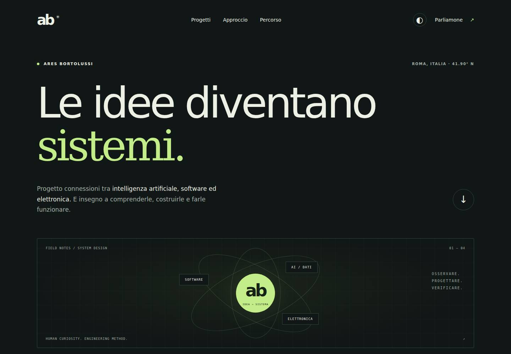

# Collaudo della revisione

22 ottobre 2026. Verifica locale su Chromium 153 con Playwright 1.64.1 e axe-core, viewport 1440×1000 e 390×1000.

- Quattro controlli automatici su intestazioni, riferimenti locali, identificativi, metadata e assenza di dipendenze runtime esterne: superati.
- Sei schede presenti senza JavaScript; controlli aggiuntivi nascosti quando JavaScript non è disponibile.
- Filtri e ripristino della selezione: verificati; tre risultati per AI/dati.
- Tema chiaro/scuro e aggiornamento dello stato accessibile: verificati.
- Nessun errore JavaScript o overflow orizzontale a entrambe le larghezze.
- Nessuna violazione rilevata dai controlli automatici axe WCAG 2 A/AA nei due temi e nelle due larghezze, dopo correzione dei contrasti.
- Immagini desktop/mobile ispezionate. Questi controlli non costituiscono una certificazione di accessibilità o un test completo con screen reader.

Esecuzione dei controlli statici: `python3 -m unittest discover -s tests -v`. Il browser non ha verificato l’invio di email né una nuova pubblicazione GitHub Pages. Il merge della pull request è separato dalla preparazione della revisione.

## Revisione professionale e interazioni — 29 ottobre 2026

Quattro test statici passati; home, pagina percorso, tre note e tre schede
verificate con Chrome headless / Playwright a 390 e 1440 px: nessun overflow di
pagina, errore JavaScript, immagine mancante o duplicazione dell'h1. Riferimenti
locali e ancore controllati su tutte le otto pagine correnti.

Esploratore delle decisioni: cambio pannello tramite click e tastiera, frecce,
Home/End, ruoli tab/tabpanel, stato selezionato e orientamento responsive.
Filtri CV: selezione hardware (due esperienze), cybersecurity (ruolo corrente),
ripristino del percorso completo. La stampa include tutte le dieci esperienze
anche se un filtro è attivo. Senza JavaScript tutti i pannelli e le esperienze
restano leggibili; i controlli aggiuntivi rimangono nascosti.

Verificato anche prefers-reduced-motion; nessuno scorrimento intercettato o storage
locale introdotto. Il sito mantiene zero dipendenze runtime remote e zero analytics.
Screenshot desktop/mobile ispezionati. PDF A4 di due pagine estratto e renderizzato
per controllo visivo: ruolo corrente presente, informazioni personali superflue
assenti, formazione e competenze presenti. Corretta anche la precedenza della
palette di stampa, che ora usa testo scuro su sfondo bianco indipendentemente
dal tema scelto per il sito. Nessuna certificazione di accessibilità implicata.
